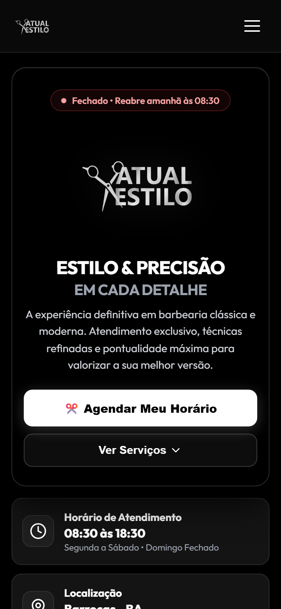
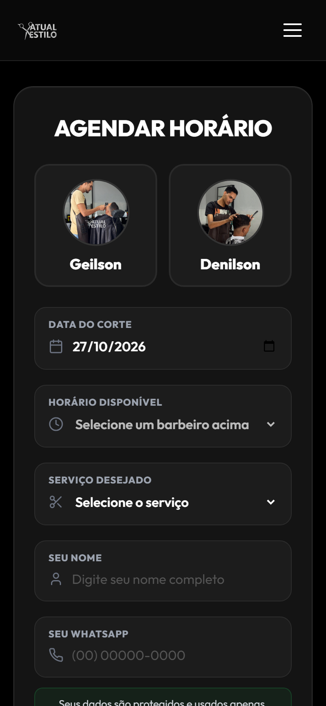

# AtualEstilo Barbearia — Online Booking System

> Website and online booking system for a barbershop: clients book, check and cancel appointments 24/7, and the owner runs the schedule from an admin panel.

  

## Highlights

<!-- XYZ: "Accomplished [X] as measured by [Y], by doing [Z]". Troque/adicione números de negócio que o cliente autorizar. -->

- **Moved bookings from WhatsApp to self-service**, as measured by booking, checking and cancelling available 24/7 without talking to a barber, by building a booking flow that shows only truly free slots and notifies the chosen barber on WhatsApp.
- **Prevented double bookings**, as measured by a second database check of the slot right before confirming, by making the confirmation atomic so two clients booking the same time can't both succeed.
- **Cut repetitive admin work for fixed clients**, as measured by up to 52 future appointments created and cancelled in one action, by adding weekly, biweekly and monthly recurring bookings grouped per client.
- **Ran a full booking system on low-cost shared hosting**, as measured by production on a Hostinger shared plan with no Node server, by writing the production API in plain PHP while keeping a Node version for development and tests.

## The story (STAR)

### Situation

Appointments were managed through WhatsApp messages: constant back-and-forth to find a free slot, the risk of two clients booked at the same time, and barbers interrupted mid-cut to answer messages.

### Task

Give the shop a website where clients book on their own, the barbers stop managing the schedule by chat, and the owner controls hours, blocks and recurring clients, all on the shop's existing shared hosting.

### Action

- **Booking flow (`/agendar`):** choose barber, date, service and slot. Past and taken times are removed in real time, Sundays and holidays are blocked, and the phone number is remembered on the device for the next visit.
- **Self-service (`/meus-agendamentos`):** clients see and cancel bookings with only their WhatsApp number, and the barber is notified when a slot frees up.
- **Admin panel:** appointments by date with filters, complete/free actions, block several slots at once, edit working hours, and recurring clients grouped so a whole series can be cancelled at once.
- **Rewrite with a real database:** the first version (January 2026) was plain HTML/JS on Supabase. I rebuilt it in React with a relational MySQL schema and an API I control, to support the admin features the shop needed.
- **Security:** prepared statements on every query, JWT-protected admin, bcrypt-hashed passwords, rate limiting on login and booking, and security headers.
- **Performance on a cheap host:** WebP images, Gzip and cache rules in `.htaccess`, SPA routing and forced HTTPS.

### Result

- Clients book 24/7 on their own, and barbers receive each booking as a ready-made WhatsApp message.
- Double bookings are prevented by the system instead of depending on someone checking a notebook.
- The site is live at [atualestilo.com](https://atualestilo.com) on the shop's existing hosting.

<!-- Adicione resultados medidos e autorizados pelo cliente, ex.: "X% dos horários agendados pelo site", "X horas/semana economizadas". -->

## Tech stack

React 18 · Vite · PHP 8 REST API · Node.js / Express · MySQL · JWT · bcrypt · Vitest · Docker · Hostinger

## Screenshots

  

| Home (mobile) | Booking (mobile) |
| --- | --- |
|  |  |

<!-- Adicione prints do painel admin com dados fictícios -->

## About this repository

The source code is private due to client confidentiality. This page documents the project, my role and the decisions behind it.
Want something similar for your business? [Get in touch](https://schaidenunes.com/).

**My role:** Full-stack developer, solo project, from requirements to deploy
**Duration:** first version in January 2026, React rewrite from August 2026 (70+ automated tests)
